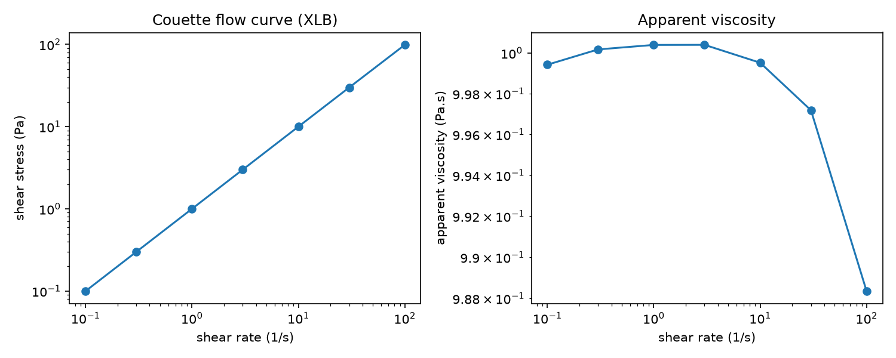
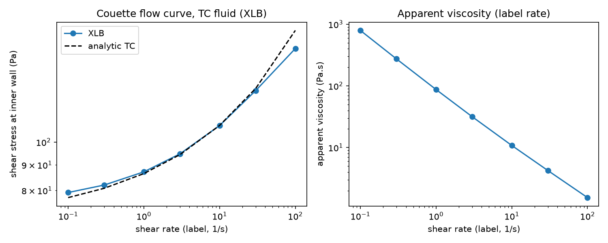

# xlb-skill

Skill teaching an agent to run open-source XLB (JAX lattice
Boltzmann) simulations from an English discussion — starting with a
Couette rheometer flow curve. **Public repo. No license needed,
no C++ compiler needed — XLB installs with pip.**

XLB (Autodesk Research) is a Python lattice Boltzmann library built
on JAX, Apache-2.0. It runs on CPU, single GPU (Warp backend) and
multi-GPU (Neon backend), and it is differentiable. This is the XLB
counterpart of the private `mstar-skill` repo and the public
`palabos-skill` repo: same workflow, same Couette example,
different solver — pip-installable, GPU-ready.

## Quickstart

```bash
git clone https://github.com/marcocaggioni/xlb-skill.git
cd xlb-skill
uv sync              # installs XLB, JAX (CPU), warp-lang, numpy, matplotlib, pyyaml
bash scripts/check-setup.sh
copilot
```

First prompt:

```
/xlb-simulation run the Couette example in examples/couette/case.yaml
```

Or one go: `copilot -i "Use the /xlb-simulation skill to run the Couette example in examples/couette/case.yaml"`. Copilot must be started from the repo root; if the skill was added mid-session, run `/skills reload`. See `QUICKSTART.md`.

## The workflow

1. **Discuss** in English — geometry, fluid + rheology, sweep, what is measured.
2. **Write `case.yaml`**, show it, get a yes. Never skip this, never invent a number.
3. **Lattice parameters** — `lattice.py` converts physical → lattice units and checks the low-Mach condition. This is the step M-Star hides.
4. **Run** the Python case (`uv run python examples/couette/couette.py`). Dry-run by default.
5. **Sweep / run** — one run per shear rate, torque CSV per run.
6. **Post-process** torque → flow curve, with a mandatory Newtonian validation gate (analytic Couette torque, ~10%).
7. **Report** — plot + CSV + video + assumptions + validation + unverified items.

## The Couette example

Fluid in a Couette rheometer, inner cylinder rotating, outer fixed,
torque on the bob → flow curve. Defaults (labelled, to confirm):
R_i = 0.020 m, R_o = 0.025 m, L = 0.060 m, Newtonian η = 1.0 Pa·s,
ρ = 1000 kg/m³, γ̇ = 0.1 → 100 s⁻¹ log-spaced, 10 cells across the
gap. 2D cross-section first (torque per unit length); 3D is a
follow-up. Same numbers as the M-Star and Palabos examples, so the
solvers can be compared point for point.

Two XLB-specific facts: the rotating wall is split into angular
sectors (one `HalfwayBounceBackBC` per sector, because XLB's JAX BC
takes one constant wall velocity per BC object), and the run is
initialised with the analytic Couette profile instead of a
time-varying ramp (the wall velocities are baked into the compiled
stepper). Both are documented in `examples/couette/RUN_REPORT.md`.

## Results — it ran

<video src="https://raw.githubusercontent.com/marcocaggioni/xlb-skill/main/examples/couette/couette-sweep.mp4" controls></video>

Steady state at each shear rate, γ̇ = 0.1 → 100 s⁻¹. The spin-up at γ̇ = 10 s⁻¹ is in [couette-gamma10.mp4](examples/couette/couette-gamma10.mp4).



Newtonian validation **PASSED**: max analytic-torque error **1.16%**, η_app = 0.988–1.000 Pa·s (true 1.0). Caveat, measured: the halfway bounce-back leaks mass at the curved moving wall, so runs are capped at 3,000 steps per point and the γ̇ = 100 velocity profile runs ~18% fast. Full numbers in [examples/couette/RUN_REPORT.md](examples/couette/RUN_REPORT.md).

## The TC Couette example

The same cell with the three-component (TC) model fluid instead of
Newtonian — `examples/couette-tc/`:

    tau = sigma_y + sigma_y*sqrt(gamma_dot/gamma_dot_c) + eta_bg*gamma_dot

σ_y = 70 Pa, γ̇_c = 100 1/s, η_bg = 0.05 Pa·s (50 cP). Same geometry
(R_i = 0.020 m, R_o = 0.025 m, L = 0.060 m) and the same sweep
labels, γ̇ = 0.1 → 100 s⁻¹. XLB ships no rheology dropdown, so the
TC law lives in a custom BGK collision operator (`tc_collision.py`):
the local relaxation frequency is computed from the local strain
rate, read off the non-equilibrium stress tensor — the same pattern
as XLB's own Smagorinsky operator — with the local (γ̇, τ) pair
solved implicitly per node by bisection.

Two TC-specific facts: the viscosity is regularized with a cap,
η = min(η(γ̇), η_max), η_max = η(1e-3 1/s) = 7.02214e4 Pa·s, because
η(γ̇) diverges as γ̇ → 0; and dt is solved **per sweep point** from
the viscosity at that point's label rate (ω_ref = 1.0), from
5.77e-8 s at γ̇ = 0.1 to 2.87e-5 s at γ̇ = 100, keeping ω at the
inner wall at 1.17–1.82. Precision is FP64FP64 — at γ̇ = 0.1 the
lattice wall speed is u_lb ~ 4e-8, below FP32's useful signal.
At γ̇ ≤ 10 the analytic solution has a genuine unyielded plug
attached to the outer wall (R_y = 21.03 mm at γ̇ = 0.1, 24.84 mm
at γ̇ = 10); the flow curve is validated on **torque** against the
analytic TC torque, not on η_app at the label rate (the true
inner-wall rate exceeds the label rate: 1.10 1/s at label 0.1,
162 1/s at label 100).

<video src="https://raw.githubusercontent.com/marcocaggioni/xlb-skill/main/examples/couette-tc/couette-tc-sweep.mp4" controls></video>

Steady state at each shear rate, γ̇ = 0.1 → 100 s⁻¹. The run at γ̇ = 10 s⁻¹ is in [couette-tc-gamma10.mp4](examples/couette-tc/couette-tc-gamma10.mp4).



TC validation **PASSED**: max analytic-torque error **8.02%**
(at γ̇ = 100; tolerance 10%), γ̇ = 10 check −0.05%. Per-point
torque error: +2.37%, +1.51%, +0.80%, +0.36%, −0.05%, −1.00%,
−8.02% from γ̇ = 0.1 to 100. Caveats, measured: the mass leak
hits TC harder than Newtonian at γ̇ = 100 (−10.7% density over
3,000 steps → −8.0% torque, because shear-thinning breaks the
Newtonian self-compensation), and the velocity profile deviates
from the analytic TC profile near the yield surface — a ~1%
stress discrepancy amplified by γ̇ ∝ (τ−σ_y)² — while the torque
stays accurate. Do not trust the velocity field near the plug;
the torque is the validated observable. Full numbers in
[examples/couette-tc/RUN_REPORT.md](examples/couette-tc/RUN_REPORT.md).

## How this compares

Same Couette case, same validation, five solvers. Full write-up: [docs/comparison.md](docs/comparison.md).

| Solver | Method | Repo | Validation (max error) | η_app | Sweep video |
|---|---|---|---|---|---|
| M-Star | LBM, GPU, licensed | [mstar-skill](https://github.com/marcocaggioni/mstar-skill) (private) | not yet run | — | — |
| Palabos | LBM, C++/MPI, AGPLv3 | [palabos-skill](https://github.com/marcocaggioni/palabos-skill) | 1.43% | 1.0143 | [video](https://github.com/marcocaggioni/palabos-skill/blob/main/examples/couette/couette-sweep.mp4) |
| XLB | LBM, Python/JAX | [xlb-skill](https://github.com/marcocaggioni/xlb-skill) | 1.16% | 0.988–1.000 | [video](https://github.com/marcocaggioni/xlb-skill/blob/main/examples/couette/couette-sweep.mp4) |
| OpenFOAM | Finite-volume, GPL | [openfoam-skill](https://github.com/marcocaggioni/openfoam-skill) | 0.03% | 1.0003 | [video](https://github.com/marcocaggioni/openfoam-skill/blob/main/examples/couette/couette-sweep.mp4) |
| OpenLB | LBM, C++/CUDA, GPLv2 | [openlb-skill](https://github.com/marcocaggioni/openlb-skill) | 0.94% | 1.0093 | [video](https://github.com/marcocaggioni/openlb-skill/blob/main/examples/couette/couette-sweep.mp4) |

## Status — v0.1

- `lattice.py` and `couette_post.py`: **tested** (lattice check
  passes; post-processing recovers η ≈ 1.0 Pa·s on synthetic
  torque, validation PASSED).
- `couette.py`: **run for real on this VM** (XLB v0.3.2, JAX
  backend, CPU) — full sweep γ̇ = 0.1 → 100 s⁻¹, Newtonian
  validation **PASSED, max analytic error 1.16%**
  (η_app = 0.988–1.000 Pa·s). See `examples/couette/RUN_REPORT.md`
  for the numbers, videos and remaining limitations — including
  the measured mass leak at the curved moving wall, which caps
  runs at 3,000 steps per point.
- Not yet run on a GPU (Warp/Neon backends need NVIDIA hardware).
- `couette-tc/`: **run for real on this VM** (XLB v0.3.2, JAX
  backend, CPU, FP64) — full sweep γ̇ = 0.1 → 100 s⁻¹, TC
  validation **PASSED, max analytic-torque error 8.02%**
  (γ̇ = 10 check −0.05%). See `examples/couette-tc/RUN_REPORT.md`
  for the numbers, videos and remaining limitations — including
  the mass leak, which costs −8% torque at γ̇ = 100 for a
  shear-thinning fluid, and the velocity-profile deviation near
  the yield surface.

## Files

- `skills/xlb-simulation/SKILL.md` — the skill, mirrored at `.github/skills/xlb-simulation/SKILL.md`
- `docs/xlb-guide.md` — install, backends, lattice units, non-Newtonian notes, limits
- `examples/couette/` — the worked Newtonian example
- `examples/couette-tc/` — the three-component (TC) fluid example
- `scripts/check-setup.sh` — readiness check (uv, python, xlb import, backend)

XLB: https://github.com/Autodesk/XLB (Apache-2.0).
This repo's own code: MIT.
